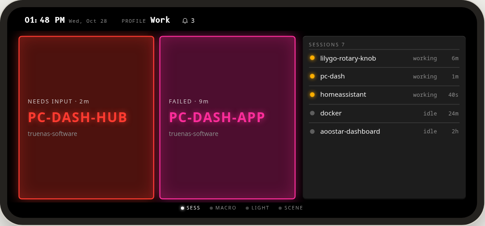
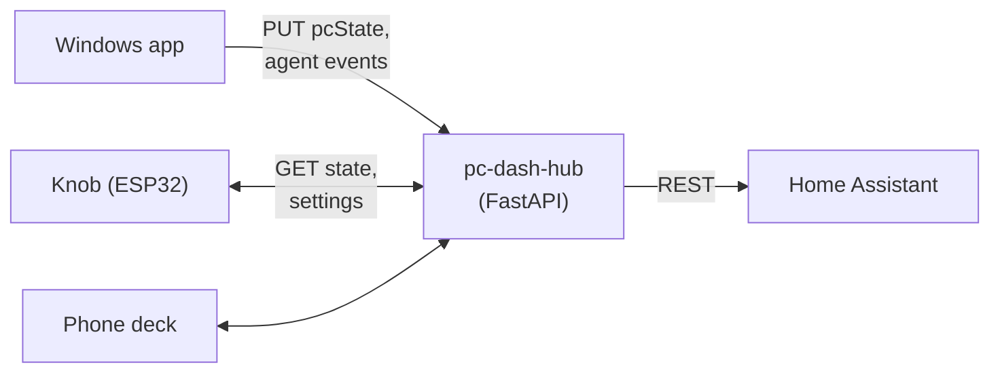
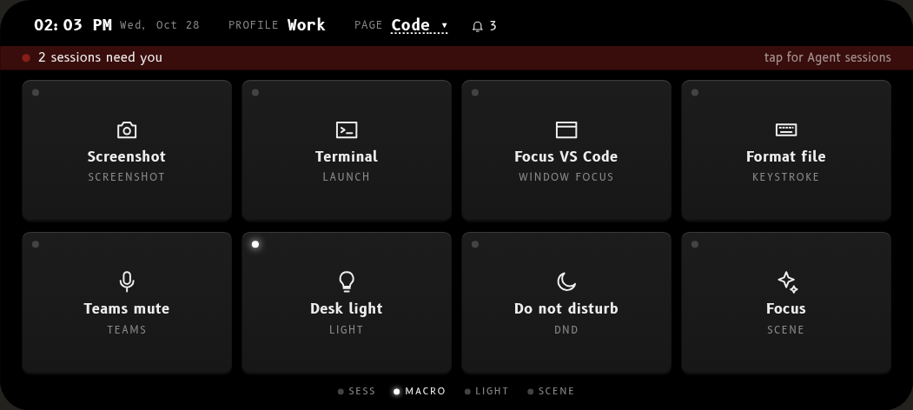
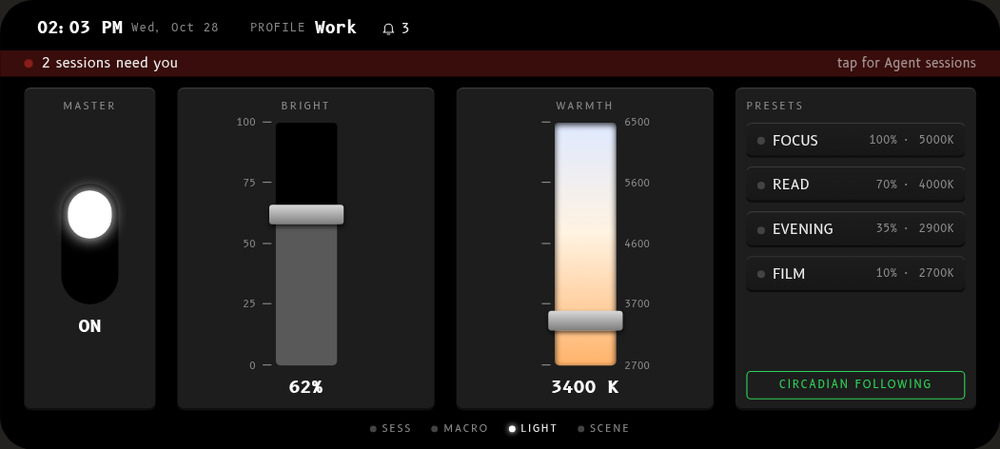
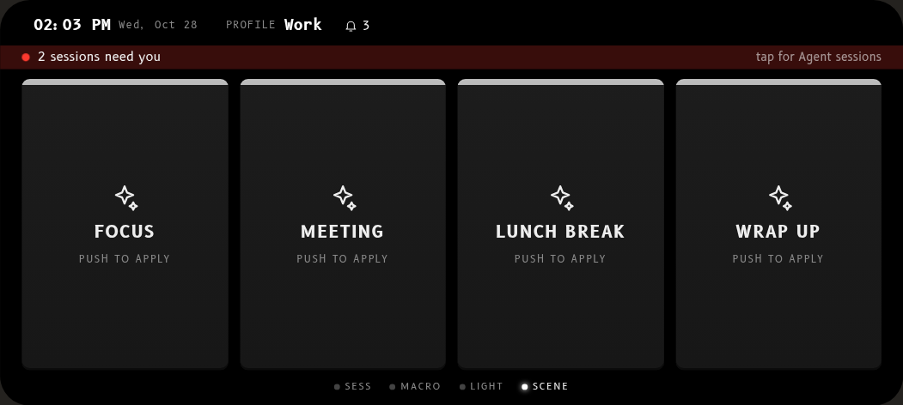
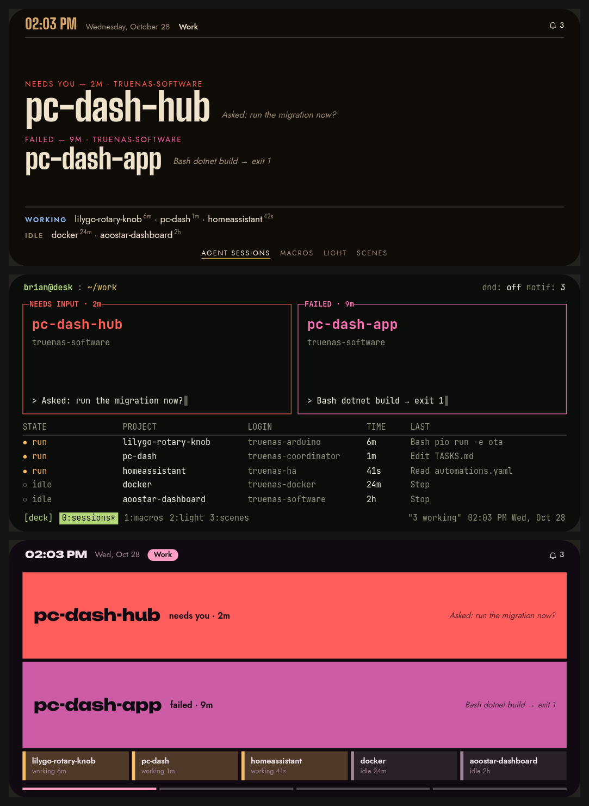

# PC Dash Hub

[](https://github.com/btkramer/pc-dash-hub/actions/workflows/ci.yml)


A small self-hosted FastAPI service, run in Docker, that sits at the center of the PC Dash
ecosystem. The knob, the Windows app and any browser talk to the hub instead of to each other:
it stores and merges settings, relays live PC state with server-computed staleness, tracks
Claude Code agent sessions and passes smart-home actions to Home Assistant.



<sub>Design prototype of the phone deck the hub serves: sessions that need input or have failed light up.</sub>

Part of the **PC Dash** family:

| Repo | Role |
|---|---|
| [lilygo-rotary-knob](https://github.com/btkramer/lilygo-rotary-knob) | The knob: ESP32-S3 firmware with a round AMOLED display |
| **pc-dash-hub** (this repo) | Self-hosted hub |
| [pc-dash-app](https://github.com/btkramer/pc-dash-app) | Windows companion app that reports real PC audio, media and agent state |



## Phone deck

The hub also serves a landscape phone "deck" with four swipeable screens: agent sessions,
macros, light and scenes.

| | |
|:---:|:---:|
|  |  |
| **Macros**: a key grid that runs actions on the PC or through Home Assistant | **Light**: power, brightness and warmth faders, circadian presets |
|  | |
| **Scenes**: one-press room setups | |

Themes are shared with the knob:



<sub>Deck screens are from the v2 design prototype.</sub>

## API

| Endpoint | Purpose |
|---|---|
| `GET/PUT /api/devices/{id}/state` | Per-device settings (deep-merged on PUT) plus the relayed `pcState`, with `pcConnected` and staleness computed by the server |
| `GET/PUT /api/settings` | Shared settings document |
| `GET /api/pc-status` | Is the companion app alive, and what is it reporting |
| `GET/PUT/DELETE /api/agent-sessions[/{id}]` | Claude Code session status feed for agent-monitor mode |
| `GET/POST /api/logos`, `GET/PUT /api/logo-assignments/{key}` | Project-logo uploads and assignments |
| `GET /api/generic-icons[/{name}]` | Built-in icon set |
| `GET/POST /light` | Home Assistant light passthrough |
| `GET /` | Browser control page (macro grid) |
| `GET /health` | Health check |

## Running

```sh
cp .env.example .env    # set HA_URL, HA_TOKEN, HA_LIGHT_ENTITY
docker build -t pc-dash-hub .
docker run -d --name pc-dash-hub -p 8015:8000 --env-file .env \
  -v pc-dash-hub-data:/app/data pc-dash-hub
```

Settings and logos persist under `DATA_DIR` (default `data/`). Use a long-lived Home Assistant
token from a dedicated, least-privilege user.

## Testing

```sh
pip install -r requirements-dev.txt
pytest
```

The suite uses FastAPI's `TestClient`, a fresh temporary data directory per test and an in-memory
stand-in for Home Assistant, so it never touches real data or the network. CI runs it, plus a
Docker build, on every push and pull request.

## Security model

The hub is built for a **trusted home LAN**. It has **no authentication** by default: anything that
can reach its port can read and change device state, settings, agent sessions and logos, and can
switch the Home Assistant light it's configured for. **Do not expose it to the internet** (no port
forwarding, no public reverse proxy). For remote access, use a VPN such as WireGuard or Tailscale.

The Home Assistant token stays on the hub and is never sent to clients, but the hub will use it on
behalf of anyone who can reach it. That's another reason to give it a dedicated, least-privilege HA
user.

**Optional token (off by default).** Set `HUB_TOKEN` and every request except `/health` must send
`Authorization: Bearer <HUB_TOKEN>`; anything else gets `401`. The knob firmware, pc-dash-app and
the phone deck don't send a token yet, so turning this on today locks them out. It's there for
scripts and for future client support. With `HUB_TOKEN` unset, behavior is unchanged.
